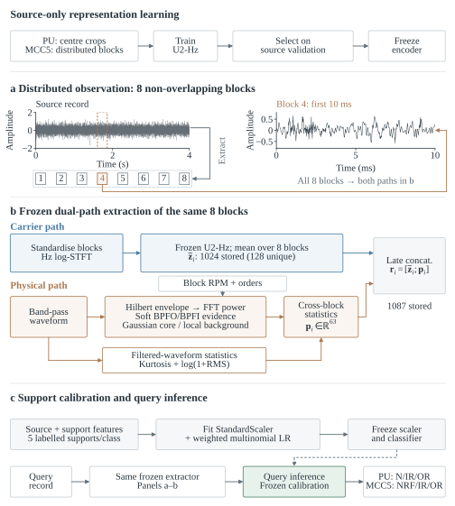

# RAMEF

**Rotation-aware measurement evidence fusion for cross-speed five-shot bearing fault diagnosis**

[English](README.md) · [论文与代码映射](docs/MANUSCRIPT_MAP.md) · [复现说明](docs/REPRODUCIBILITY.md) · [引用方式](CITATION.md)

RAMEF面向跨转速五样本轴承故障诊断，将分布式观测、可学习共振载波、几何约束物理证据和目标support校准纳入同一流程。方法以**一条完整物理测量记录（measurement）为决策单位**，每类使用5条带标签目标记录进行校准。

本仓库提供模型与实验源码、固定划分清单、历史类别预测、指标复算工具和论文配图。

## 方法流程

1. **分布式观测。** 从同一记录提取8个分布式、不重叠block，增加记录内的观测覆盖。block不是新增标注样本，也不计作额外shot。
2. **证据提取与融合。** 冻结U2-Hz编码器提取标准化Hz域视图的载波表示，对8个block的嵌入取均值；物理路径并行计算软BPFO/BPFI证据和滤波波形统计量，聚合为63维物理描述符。两类表示在measurement级拼接。
3. **校准与诊断。** 源特征与每类5条目标support共同拟合标准化器和正则化多项逻辑回归分类头。冻结校准包后，对query逐记录诊断。

U2-Hz仅使用源数据训练，并由源验证选择检查点。PU源训练使用中心crop，MCC5源训练使用分布式block；检查点确定后编码器冻结。物理路径不含可训练参数。在所报告的校准和推理流程中，query不参与拟合统计量、参数更新或模型选择。



**命名说明：** 当前统一使用RAMEF。历史脚本、预测字段或日志中的`RAMEF-F`是同一完整63维实现的旧别名，原始记录和哈希保持不变。

## 快速开始：校验与指标复算

在仓库根目录使用**Python 3.10或更高版本**运行以下命令。这三个步骤仅依赖Python标准库，不需要GPU、原始振动数据或模型权重。

```bash
python scripts/verify_bundle.py
python -m unittest discover -s tests -v
python scripts/replay_paper_results.py --output-dir runs/replay01
```

输出目录必须尚不存在。复算脚本读取历史类别预测并重新计算指标，不重新训练网络，也不执行新的模型推理。

| 输出文件 | 内容 |
|---|---|
| `pu_metrics.csv` | PU指标及混淆矩阵，每条不同measurement计一票 |
| `mcc5_seed_metrics.csv` | MCC5各方法、各编码器种子的运行级指标 |
| `seed_summary.csv` | 种子均值与样本标准差 |
| `summary.json` | 参考值核对、输入哈希及评分定义 |

本地检查已覆盖**41项单元测试**、完整文件清单校验、预测指标复算，以及Windows Git换行处理后的字节一致性。检查范围与运行环境见[本地检查记录](docs/LOCAL_PACKAGE_CHECKS.json)。

## 实验任务与参考结果

### PU：真实损伤跨转速开发任务

源工况D0、DM、DF均为1500 rpm，目标工况DS为900 rpm；任务为正常（N）、内圈故障（IR）和外圈故障（OR）三分类。源训练与验证分别包含816和204条measurement。编码器检查点确定后，1020条源measurement与15条目标support用于最终校准。

主评分对**171条不同query measurement各计一票**，其中N、IR、OR分别为55、62、54条。support与query的measurement身份互斥。

| 锁定方法 | Accuracy（%） | Macro-F1（%） |
|---|---:|---:|
| Centre-crop U2-Hz | 88.89 | 88.16 |
| U2-Hz-DM8 | 97.66 | 97.55 |
| RAMEF | 98.83 | 98.78 |

另一组在该轮运行前固定种子的五种子RAMEF实验得到**94.04% ± 1.91% Accuracy**和**93.76% ± 2.00% Macro-F1**，与锁定单模型结果分开报告。

历史240-entry账本包含重复measurement身份。复算时先核对重复条目的预测一致性，再按唯一身份计票。PU query在项目早期开发中曾被访问，因此这些结果属于**锁定且历史已访问的开发队列**，不是未触碰的外部确认，也不代表未见轴承个体泛化。

### MCC5：电机故障干扰下的运行级滚道定位

本地预先指定的MCC5任务包含42条3000-rpm标称源训练运行、42条2000-rpm标称源验证运行，以及1000-rpm标称目标域中的15条support和**27条query运行**。query的NRF、IR、OR分别为13、7、7条。最终校准仅使用42条源训练运行和15条support，不包含源验证运行。

NRF表示不存在内圈或外圈滚道故障，不等于整机完全健康；IR和OR包括纯滚道故障及与其他电机故障叠加的复合故障。滚动体故障及内外圈同时损伤的运行不纳入任务。

| 本地预先指定比较 | Accuracy（%） | Macro-F1（%） |
|---|---:|---:|
| U2-Hz-LM8：局部八block载波 | 67.41 ± 4.06 | 60.25 ± 7.18 |
| U2-Hz-DM8：分布式八block载波 | 79.26 ± 6.20 | 75.17 ± 7.11 |
| RAMEF | 96.30 ± 2.62 | 96.23 ± 2.81 |

表中为**同一组27条运行上5个编码器种子的均值±样本标准差**，不是5个独立队列或总体置信区间。MCC5证据定位为本地预先指定的**运行级机理压力测试**，不属于第三方预注册或轴承个体级确认。query-free support审计只涉及已注册的15条support邻域；后续容量、维度及同物理证据对照均保持冻结后的事后分析身份，不替换原96.30%结果。CWRU与SQ用于补充天花板检查。

## 从原始数据运行MCC5

请自行从数据提供方取得MCC5-THU Motor原始数据，并遵守其使用条件。先安装建模依赖，再单独安装适合本机的PyTorch版本：

```bash
python -m pip install -r requirements-model.txt
```

`requirements-model.txt`**不安装PyTorch**。原实验记录使用Python 3.13.13、PyTorch 2.12.0+cu126、NumPy 2.4.4、SciPy 1.17.1及scikit-learn 1.8.0；完整记录见[`configs/recorded_runtime.json`](configs/recorded_runtime.json)。这些记录不保证历史安装包仍可下载，也不保证其他硬件训练逐位一致。前述标准库指标复算与建模环境相互独立。

将`PATH_TO_MCC5_DATA`替换为包含`MCC5-THU Motor_speed_circulation`子目录的父目录，使用新的工作目录执行：

```bash
# 只检查准备阶段命令，不读取波形。
python scripts/mcc5_pipeline.py prepare --data-root "PATH_TO_MCC5_DATA" --work-dir runs/mcc5_fresh --dry-run

# 准备源训练、源验证及support数据。
python scripts/mcc5_pipeline.py prepare --data-root "PATH_TO_MCC5_DATA" --work-dir runs/mcc5_fresh

# 源训练，并依据源验证选择检查点。
python scripts/mcc5_pipeline.py train --work-dir runs/mcc5_fresh

# 检查点选择完成后，执行独立锁定的评价阶段。
python scripts/mcc5_pipeline.py evaluate --data-root "PATH_TO_MCC5_DATA" --work-dir runs/mcc5_fresh
```

保持原始证据目录不变，不删除评价锁以在同一工作目录重复评价。重新训练属于既有任务上的计算复现，不构成新的独立目标队列。本地包测试验证了运行入口及已有预测复算，并未验证全新机器上的完整原始数据训练。

## 仓库结构

| 位置 | 内容 |
|---|---|
| `code/` | 模型、物理描述符和历史实验实现 |
| `scripts/` | 完整性校验、指标复算和MCC5便携入口 |
| `configs/` | 当前参数及软件环境记录 |
| `protocols/` | 数据划分、角色清单及历史协议 |
| `evidence/` | 指标复算所用类别预测 |
| `reference/` | 历史统计及数值参考输入 |
| `figures/current/` | 正式主稿SVG图及其清单 |
| `figures/source/fig1/` | 现行图1源码链及来源元数据 |
| `docs/` | 脚本索引、论文映射、模型资产及来源说明 |
| `tests/` | 标准库入口、指标与分发包测试 |

常用说明：

- [脚本索引](docs/SCRIPT_INDEX.md)：各入口用途及执行前提。
- [论文映射](docs/MANUSCRIPT_MAP.md)：章节、表格与代码/证据的对应关系。
- [图源说明](figures/README.md)：正式成图、绘图脚本及外部输入。
- [版本映射](docs/MANUSCRIPT_VERSION.json)：主稿和补充材料的精确身份。
- [模型资产清单](docs/EXTERNAL_MODEL_ASSETS.csv)：原模型文件名及哈希。

历史PU/CWRU/SQ入口和部分绘图脚本需要阶段缓存或另行取得的资产。本仓库**不包含**模型检查点、拟合分类器、原始振动、特征缓存及论文PDF。图1所用波形CSV是外部依赖；图7复用冻结坐标，不重新拟合t-SNE。

`.gitattributes`用于保持跨平台文件字节一致。若旧Windows检出已转换换行，请重新取得干净副本，不改写历史哈希。当前分发更新和操作说明分别见[CHANGELOG.md](CHANGELOG.md)及[UPLOAD_INSTRUCTIONS.md](UPLOAD_INSTRUCTIONS.md)。

## 引用与许可

对应未发表稿：

> Shuanglin Zhang, Hao Zhang, Liang Zhang and Yuanhang Sun. *Rotation-aware measurement evidence fusion for cross-speed five-shot bearing fault diagnosis*. Unpublished manuscript, 2026.

版本化引用说明见[CITATION.md](CITATION.md)。本仓库包未分配论文发表DOI或归档DOI。

软件授权和第三方权利说明见[LICENSE_STATUS.md](LICENSE_STATUS.md)及[THIRD_PARTY_NOTICES.md](THIRD_PARTY_NOTICES.md)。仓库公开本身不等于已授予开源许可证，本包不擅自授予软件许可或重新授权原始数据集。
